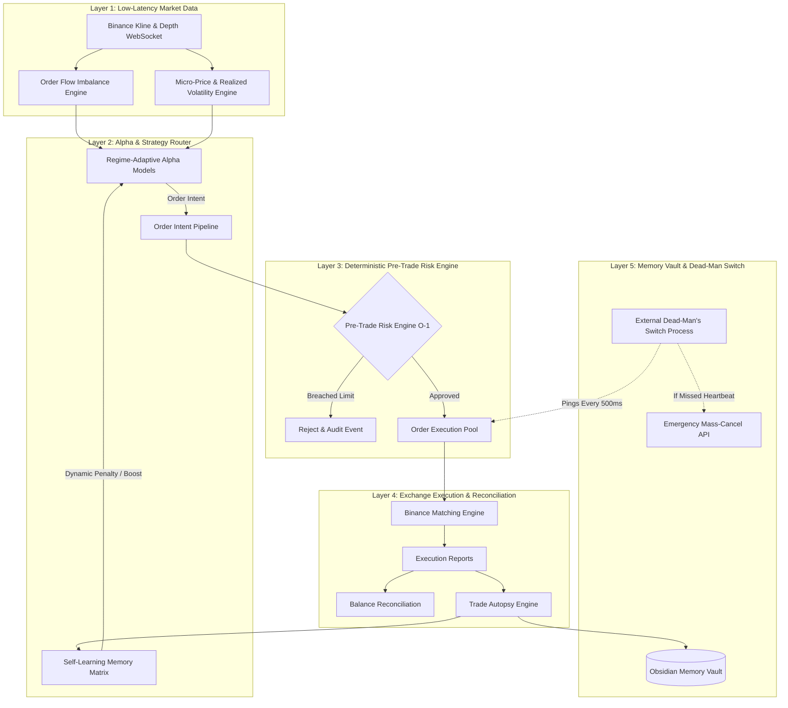
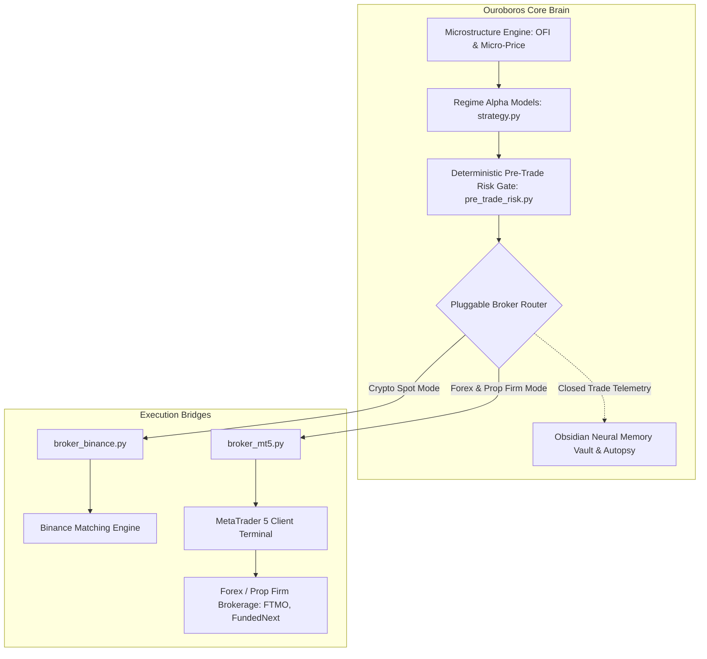

# 🏛️ Production Architecture: The Millionaire Trader Quantitative System

This document outlines the complete architectural, mathematical, and operational blueprint for the **Ouroboros Quantitative Trading Engine**, engineered to compound capital systematically while mathematically eliminating catastrophic risk.

---

## 1. The "Millionaire Trader" Mathematics: Asymmetric Compounding

Retail traders believe making money in crypto requires 50x leverage and dozens of trades per day. **Quantitative hedge funds and elite traders know this is a mathematical death sentence.**

### The Geometric Growth Formula
Wealth growth over time is governed by the continuous geometric compounding equation:
$$G = \mu - \frac{1}{2} \sigma^2$$

Where:
- $G$ = Geometric Growth Rate (the actual rate at which your net worth expands).
- $\mu$ = Expected arithmetic return of your strategy.
- $\sigma^2$ = **Variance of returns (Volatility of your PnL)**.

> [!IMPORTANT]
> **The Variance Drag Law**:
> Notice the negative sign in front of $\frac{1}{2} \sigma^2$. Every time your account suffers a large drawdown, it squares the damage to your compounding curve! 
> - A **-10% loss** requires an **+11% gain** to break even.
> - A **-30% loss** requires a **+43% gain** to break even.
> - A **-50% loss** requires a **+100% gain** just to get back to zero!

Therefore, the secret to compounding capital like an institutional quant is **not maximizing the number of trades**, but **strictly truncating downside variance ($\sigma^2 \to 0$)** through hard, deterministic pre-trade gates while letting winners run in favorable regimes.

---

## 2. The 5-Layer Production Architecture



---

## 3. Subsystem Breakdown

### Layer 1: Micro-Price & Order Flow Imbalance (`orderflow_engine.py`)
Standard retail bots trade on the simple mid-price ($P_{\text{mid}} = \frac{P_{\text{bid}} + P_{\text{ask}}}{2}$). Ouroboros incorporates **Micro-Price (Volume-Weighted Mid)**:
$$P_{\text{micro}} = \frac{V_{\text{ask}} \cdot P_{\text{bid}} + V_{\text{bid}} \cdot P_{\text{ask}}}{V_{\text{bid}} + V_{\text{ask}}}$$

- When institutional buyers flood the bid queue ($V_{\text{bid}} \gg V_{\text{ask}}$), $P_{\text{micro}}$ immediately shifts upwards toward the ask price.
- **The Alpha**: The bot detects this queue pressure **before** the matching engine executes the transactions and before retail sees the next candlestick tick!

### Layer 2: Deterministic Pre-Trade Risk Gate (`pre_trade_risk.py`)
No order can touch the Binance network without passing through five synchronous, $\mathcal{O}(1)$ in-memory guardrails:
1. **Daily Drawdown Circuit Breaker**: If current daily loss exceeds $-3.0\%$ of capital, the bot immediately halts all buying.
2. **Single Order Notional Cap**: Limits maximum ticket size to prevent overconcentration.
3. **Portfolio Cumulative Exposure Cap**: Limits total exposure across all concurrent positions.
4. **Fat-Finger Price Collar**: If order price deviates $> 1.5\%$ from mid-market, the order is dropped immediately (protects against bad ticks or flash slippage).
5. **Token-Bucket Rate Limiter**: Caps requests to $\le 20\text{ orders/second}$, guaranteeing zero Binance 429 rate-limit IP bans.

### Layer 3: Independent Dead-Man's Switch Daemon (`dead_mans_switch.py`)
- Standard bots run their watchdog inside the same Python process. If the main thread hangs or deadlocks, the watchdog dies with it.
- **Our Architecture**: An independent, decoupled supervisor process continuously inspects an atomic heartbeat file emitted every 500ms by the bot.
- **The Failsafe**: If the trading bot hangs, crashes, or loses network for $> 3.5$ seconds, the Dead-Man's Switch immediately issues an authenticated API call to Binance:
  - Wipes all open limit and stop orders across all symbols.
  - Generates a hard halt flag.
  - Sends a high-priority Telegram alert.

### Layer 4: Trade Autopsy & Self-Learning Memory (`autopsy.py`, `learning_memory.py`)
- The bot hashes every setup into a quantitative fingerprint:
  `[Regime]::[Direction]::[LiquiditySkew]::[CVDAlignment]`
- Losses are classified against an institutional taxonomy:
  - `[[Mistake_CVD_Exhaustion_Trap]]`
  - `[[Mistake_Noise_Overtrading]]`
  - `[[Mistake_Overextended_Entry]]`
  - `[[Mistake_Illiquid_Spread_Slippage]]`
- Setup patterns that exhibit $< 40\%$ win rate are dynamically penalized by **-15 to -25 points**, suppressing repeat mistakes until market conditions improve.

---

## 4. The Dubai vs. Tokyo Co-location Blueprint

```
+-------------------------------------------------------------+
| OPERATOR CONTROL PLANE (Dubai, UAE)                         |
| - Flask Web Dashboard (http://127.0.0.1:8080)               |
| - Obsidian Neural Memory Vault & Interactive Graph View     |
| - Telegram Alerts & Manual Oversight                        |
+-------------------------------------------------------------+
                              |
                     ~110ms RTT Latency
                    (Monitoring & UI Only)
                              v
+-------------------------------------------------------------+
| EXECUTION PLANE (AWS Tokyo ap-northeast-1 / EC2 or VPS)     |
| - Fast Ingestion & L2 WebSocket                             |
| - Deterministic Pre-Trade Risk Engine (pre_trade_risk.py)   |
| - Dead-Man's Switch Daemon (dead_mans_switch.py)            |
| - Sub-2ms Execution to Binance Matching Engine              |
+-------------------------------------------------------------+
```

### Deployment Instructions:
1. When ready for production, deploy `earner_bot` to an AWS EC2 instance in **`ap-northeast-1` (Tokyo)** using the provided [Dockerfile](file:///c:/Users/feena/OneDrive/Documents/Agentic/earner_bot/Dockerfile).
2. Launch the independent Dead-Man daemon alongside the bot:
   ```bash
   python dead_mans_switch.py &
   python app.py
   ```
3. Your local Windows machine in Dubai stays connected as the **Control & Analytics Plane**, pulling synced trade dossiers into your **Obsidian Vault** for visual review!

---

## 5. Multi-Venue Expansion: MetaTrader 5 (MT5) Integration



### Can Ouroboros integrate with MetaTrader 5 (MT5)?
**Yes, natively.** 

If you ever want to expand our bot from Binance Spot into Forex, Gold (XAUUSD), or Prop-Firm challenges (FTMO, FundedNext, The5ers), you do not need to rewrite the quantitative brain:
1. **The Core Brain Stays 100% Identical**:
   - The **Microstructure Engine** (`orderflow_engine.py`)
   - The **Regime Strategy Engine** (`strategy.py`)
   - The **Deterministic Pre-Trade Risk Gate** (`pre_trade_risk.py`)
   - The **Self-Learning Autopsy & Obsidian Memory Vault** (`obsidian_vault_mgr.py`, `autopsy.py`)
2. **MT5 Acts Purely as the Execution Bridge**:
   - Via our official adapter [broker_mt5.py](file:///c:/Users/feena/OneDrive/Documents/Agentic/earner_bot/broker_mt5.py), the bot communicates directly with the local MT5 client terminal via the official `MetaTrader5` Python library.
   - It fires native market deals, secures brackets (`TRADE_ACTION_SLTP`), and enforces the dead-man switch across MT5 open positions.
3. **Institutional Prop Firm Compatibility**:
   - The strict **-3.0% Daily Drawdown Circuit Breaker** in `pre_trade_risk.py` is specifically calibrated to guarantee you never violate prop firm maximum daily drawdown limits (typically 5%).

